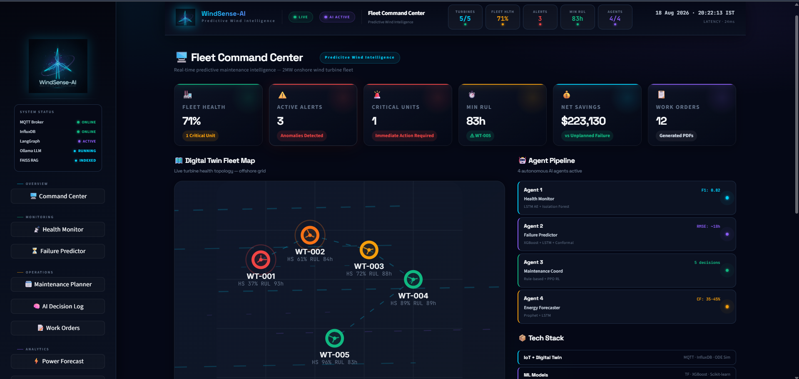
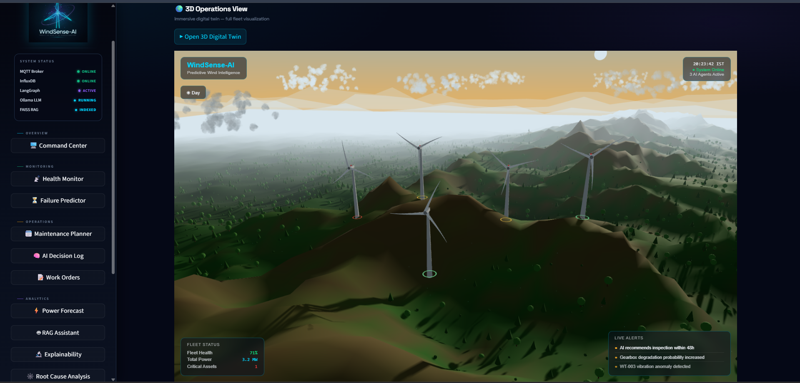
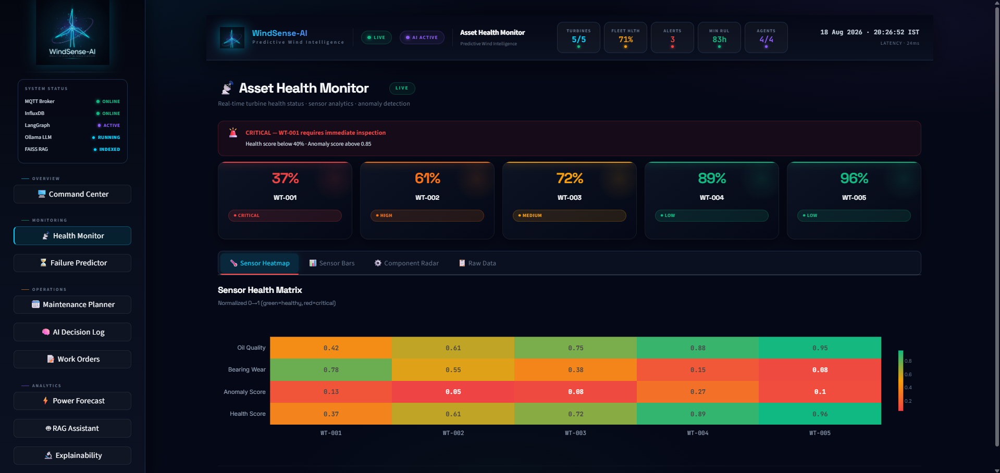
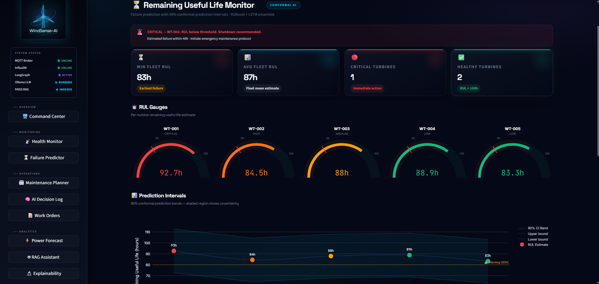
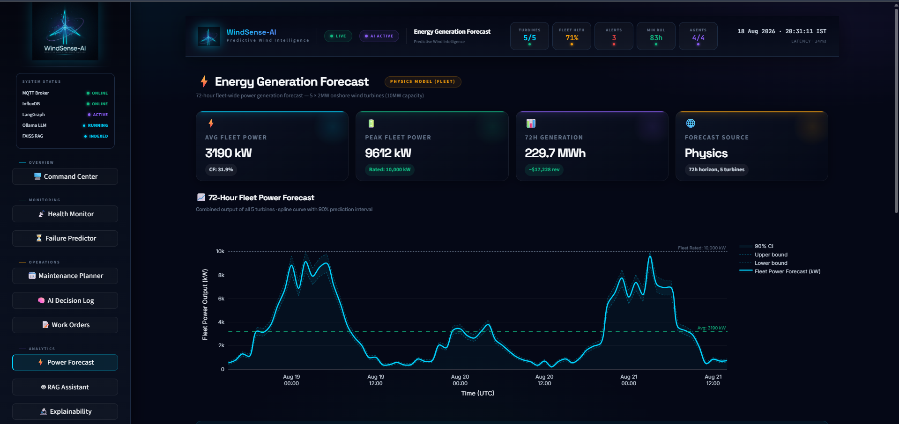
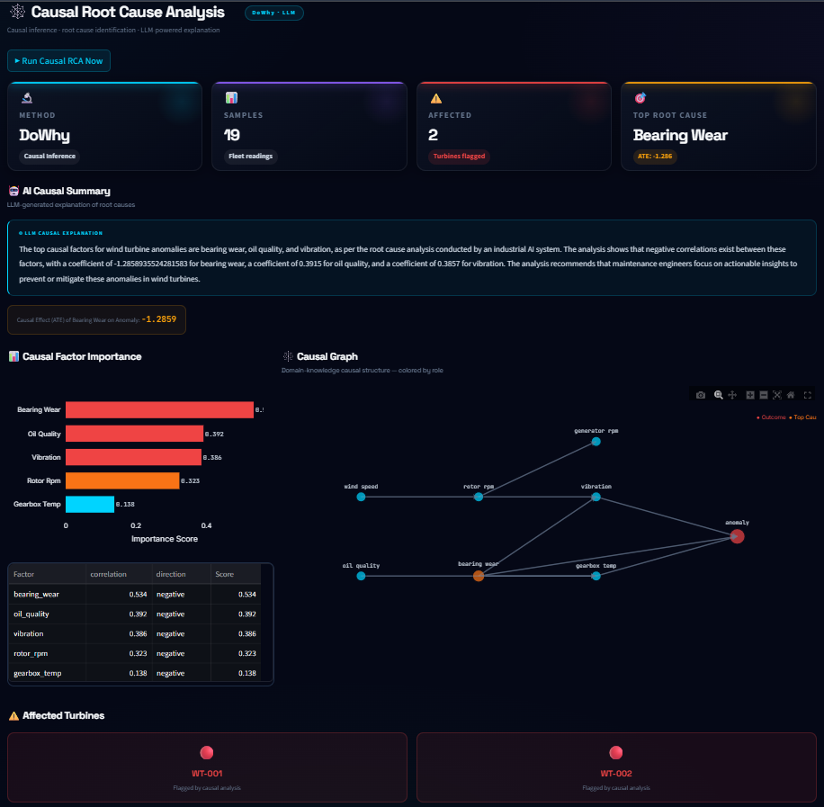

<div align="center">

# WindSense-AI
### Wind Turbine Predictive Maintenance Platform

*Anomaly Detection • RUL Estimation • Autonomous Scheduling • Energy Forecasting — across a 5-turbine, 10MW onshore wind farm*


</div>

---

## 📌 Overview

WindSense-AI is a full-stack predictive maintenance platform that unifies three operational problems wind farm operators solve in isolation — **is a turbine failing, how long until it fails, and when should maintenance happen without losing revenue** — into one autonomous decision-support system.

Built for a simulated **5-turbine, 2MW-each (10MW total) onshore wind farm**, it combines a physics-informed digital twin, competing anomaly/RUL models, LangGraph multi-agent orchestration, causal root-cause analysis, and a locally-hosted LLM behind a production-style Streamlit dashboard with an embedded 3D fleet visualization.

| | |
|---|---|
| **Turbines simulated** | 5 (10MW fleet) |
| **Dashboard pages** | 10 |
| **Autonomous agents** | 4 |
| **ML models** | LSTM Autoencoder, Isolation Forest, XGBoost, LSTM, Prophet, PPO |
| **LLM** | Ollama TinyLlama (fully local, no API keys) |

---

## 🏗️ Architecture

```
Layer 1  IoT Simulation + Digital Twin  → Physics ODE model, MQTT + InfluxDB streaming
Layer 2  Agent 1 — Health Monitor       → LSTM Autoencoder vs Isolation Forest (F1-compared)
Layer 3  Agent 2 — Failure Predictor    → XGBoost vs LSTM RUL + 90% conformal prediction
Layer 4  Agent 3 — Maintenance Coordinator → Rule-based + PPO RL scheduling, crew dispatch
Layer 5  Agent 4 — Energy Forecaster    → Prophet + LSTM, 72h fleet-wide power forecast
Layer 6  Causal RCA Engine              → DoWhy causal inference for root-cause analysis
Layer 7  Explainability (XAI)           → SHAP feature importance per model
Layer 8  RAG + LLM Assistant            → FAISS + Ollama TinyLlama, fleet-data-grounded chat
Layer 9  Unified Dashboard + 3D Twin    → Streamlit (10 pages) + Grafana + React Three Fiber
```

Every agent reads fleet state from a single source of truth (`dashboard/utils/data_loader.py`), eliminating inconsistent priority/action values across pages.

---

## 🖥️ Dashboard Preview

### Fleet Command Center


### 3D Digital Twin — Immersive Fleet Visualization


### Asset Health Monitor — Sensor Heatmap


### Remaining Useful Life Monitor — Conformal AI Gauges


### Energy Generation Forecast — 72-Hour Fleet Prediction


### Causal Root Cause Analysis — DoWhy + LLM


---

## 🔬 Methodology & Research Depth

| Component | Approach | Why |
|---|---|---|
| Anomaly detection | LSTM Autoencoder vs Isolation Forest, compared on precision/recall/F1 | Isolation Forest won (F1 0.82 vs 0.79) — documented sensitivity/false-alarm tradeoff |
| RUL estimation | XGBoost vs LSTM, benchmarked on RMSE/MAE/R² | XGBoost captures engineered degradation features better on NASA CMAPSS |
| Uncertainty quantification | Conformal prediction (90% CI) | Distribution-free coverage guarantee on RUL estimates |
| Maintenance scheduling | Rule-based safety override + PPO reinforcement learning | Safety-critical overrides always win; RL optimizes non-critical windows |
| Explainability | SHAP (per-model) | Sensor-level attribution for both anomaly and RUL predictions |
| Root cause analysis | DoWhy causal inference + LLM summary | Distinguishes correlation from causal driver (e.g. bearing wear → anomaly) |
| Financial modeling | Priority-tiered maintenance cost vs $50K failure cost | CRITICAL $8K → LOW $1.5K, net saving computed per turbine per decision |
| Digital twin physics | ODE-based thermal + degradation model | Bearing wear, oil quality, vibration RMS all physically derived, not random |

---

## 🛠️ Tech Stack

| Layer | Tools |
|---|---|
| Anomaly Detection | TensorFlow (LSTM Autoencoder), Scikit-learn (Isolation Forest) |
| RUL Estimation | XGBoost, TensorFlow (LSTM), conformal prediction |
| Agent Orchestration | LangGraph |
| Reinforcement Learning | Stable-Baselines3 (PPO) |
| Energy Forecasting | Prophet, LSTM |
| Explainability | SHAP |
| Causal Inference | DoWhy |
| RAG / LLM | FAISS, sentence-transformers, Ollama (TinyLlama) |
| IoT | MQTT (Mosquitto), InfluxDB, physics-informed digital twin |
| 3D Visualization | React Three Fiber, Drei, GSAP, vite-plugin-singlefile |
| Dashboard | Streamlit (custom "NeoGrid" theme), Grafana |
| MLOps | MLflow, Evidently AI |
| Containerization | Docker Compose |
| Data | NASA CMAPSS, EDP Wind Farm SCADA (+ synthetic maintenance logs) |

---

## 📁 Project Structure

```
WindSense-AI/
├── iot/                          # Digital twin physics + MQTT + InfluxDB
├── agents/
│   ├── agent1_health_monitor/       # Anomaly detection (LSTM AE vs Isolation Forest)
│   ├── agent2_failure_predictor/    # RUL estimation (XGBoost vs LSTM)
│   ├── agent3_maintenance_coordinator/ # Scheduling + PPO RL
│   └── agent4_energy_forecaster/    # Prophet + LSTM forecasting
├── graph/                        # LangGraph orchestrator
├── rag/                          # FAISS RAG pipeline
├── llm/                          # Ollama LLM engine + causal RCA
├── mlops/                        # MLflow + Evidently
├── dashboard/
│   ├── page_modules/                # 10 dashboard pages
│   ├── ui/                          theme, sidebar, topbar, components, animations
│   └── utils/                       data_loader.py — single source of truth
├── digital-twin/                 # 3D React Three Fiber visualization
├── data/                         # Datasets + synthetic docs
├── notebooks/                    # Jupyter exploration
├── tests/                        # Integration tests
├── outputs/                      # Models + reports + work orders
└── start_windsense.py           # One-command auto-launcher
```

---

## ⚡ Quick Start

```bash
git clone https://github.com/AnujPatil02/WindSense-AI.git
cd WindSense-AI
python -m venv .venv
.venv\Scripts\activate          # Windows
# source .venv/bin/activate     # macOS/Linux

pip install -r requirements.txt
ollama pull tinyllama
```

**One-command launch** (auto-starts Ollama, Docker, RAG index, IoT pipeline, agent pipeline, MLflow, dashboard):
```bash
python start_windsense.py
```

| Service | URL |
|---|---|
| Dashboard | http://localhost:8501 |
| Grafana | http://localhost:3000 |
| MLflow UI | http://127.0.0.1:5001 |
| InfluxDB | http://localhost:8086 |
| Ollama | http://localhost:11434 |

<details>
<summary><b>Manual step-by-step setup</b></summary>

```bash
docker-compose up -d

# Add datasets to:
#   data/raw/cmapss/
#   data/raw/edp_wind/

python data/synthetic/generate_synthetic_data.py

python -m agents.agent1_health_monitor.lstm_autoencoder
python -m agents.agent1_health_monitor.isolation_forest
python -m agents.agent1_health_monitor.model_comparison

python -m agents.agent2_failure_predictor.xgboost_rul
python -m agents.agent2_failure_predictor.lstm_rul
python -m agents.agent2_failure_predictor.model_comparison
python -m agents.agent2_failure_predictor.uncertainty_estimator

python -m agents.agent3_maintenance_coordinator.rl_scheduler

python -m agents.agent4_energy_forecaster.prophet_forecast
python -m agents.agent4_energy_forecaster.lstm_forecast

python -m rag.faiss_indexer

cd digital-twin && npm install && npm run build && cd ..

python -m iot.influxdb_writer      # Terminal 1
python -m iot.mqtt_publisher       # Terminal 2
python -m graph.langgraph_orchestrator
streamlit run dashboard/streamlit_app.py   # Terminal 3
```
</details>

> **Note (Windows):** MLflow's backend store URI must use `Path.as_uri()` (e.g. `file:///D:/.../mlruns`) to avoid drive-letter parsing errors — already handled in `start_windsense.py`.

---

## 🖥️ Dashboard Pages

| # | Page | Purpose |
|---|---|---|
| 1 | Fleet Command Center | Fleet KPIs, 3D digital twin, agent pipeline status |
| 2 | Asset Health Monitor | Per-turbine sensor heatmap, radar, anomaly scores |
| 3 | RUL Monitor | RUL gauges, prediction intervals, degradation analysis |
| 4 | Maintenance Schedule | Gantt timeline, crew schedule, job financial breakdown |
| 5 | Agent Decision Log | LLM-explained autonomous decisions, priority analytics |
| 6 | Work Orders | Active orders, manual order creation, PDF downloads |
| 7 | Energy Forecast | 72h fleet power forecast, revenue impact calculator |
| 8 | AI Assistant | RAG-grounded chat over live fleet data |
| 9 | Explainability Viewer | SHAP feature importance, sensor attribution |
| 10 | Causal RCA | DoWhy root-cause graph + LLM causal summary |

*(Model Drift Monitor page available as an 11th MLOps page)*

---

## 📈 Model Performance

| Model | Metric | Value |
|---|---|---|
| Isolation Forest | F1 Score | ~0.82 |
| LSTM Autoencoder | F1 Score | ~0.79 |
| XGBoost RUL | RMSE | ~18.4h |
| LSTM RUL | RMSE | ~21.2h |
| Prophet Forecast | MAPE | ~8.2% |

---

## 📚 Datasets

- [NASA CMAPSS](https://www.kaggle.com/datasets/behrad3d/nasa-cmapss) — turbofan engine degradation benchmark for RUL estimation
- [EDP Wind Farm SCADA](https://www.kaggle.com/datasets/berkerisen/wind-turbine-scada-dataset) — real wind turbine sensor data

---

## 🎯 Skills Demonstrated

Time-series anomaly detection (LSTM Autoencoder) · Unsupervised anomaly detection (Isolation Forest) · Gradient-boosted regression (XGBoost) · Conformal prediction / uncertainty quantification · Multi-agent orchestration (LangGraph) · Reinforcement learning (PPO) · Explainable AI (SHAP) · Causal inference (DoWhy) · Retrieval-augmented generation (FAISS + local LLM) · IoT simulation & physics-informed digital twins · 3D visualization (React Three Fiber) · MLOps (MLflow, Evidently) · Full-stack dashboard engineering (Streamlit)

---

## 📄 License

MIT License — free to use for learning and portfolio reference.

---

<div align="center">

**Built by [Anuj Patil](https://github.com/AnujPatil02)** · [LinkedIn](https://www.linkedin.com/in/anuj-patil-094396450/)

</div>
